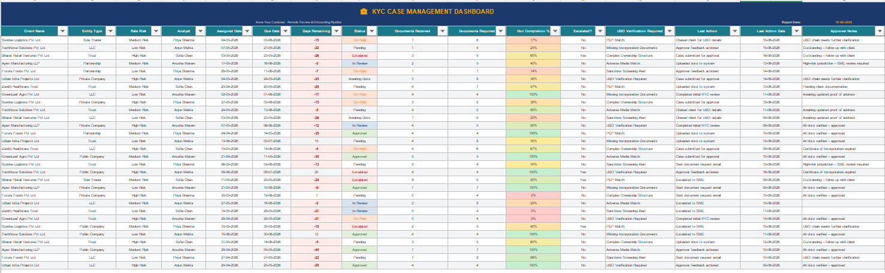
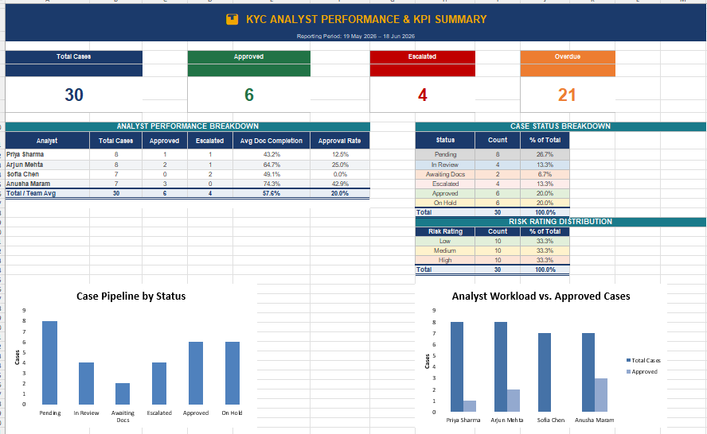
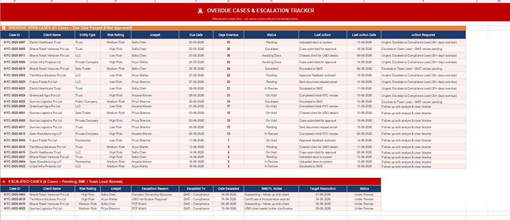
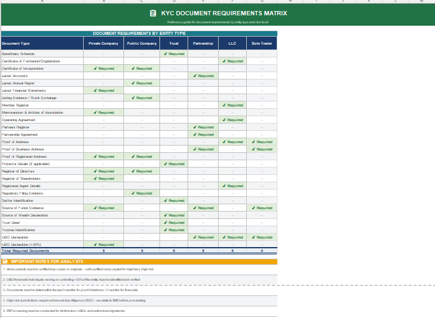

# 🏦 KYC Case Management & Analyst Performance Dashboard

An end-to-end **Know Your Customer (KYC) Periodic Review & Onboarding Tracker** built in Microsoft Excel to monitor client onboarding pipelines, SLA compliance, overdue escalations, analyst productivity, and entity-specific document checklists.

---

## 🔗 Quick Access (Live Preview & Downloads)
* 📊 **[Live Interactive Dashboard (Google Sheets)](https://drive.google.com/file/d/1eT9Spymtyqf4fqp5i0RRVTPGmcKE0j63/view?usp=sharing)** *(View formulas & tabs directly in browser)*
* 📄 **[Full 4-Page Executive Report (PDF)](./KYC_Case_Management_Dashboard.pdf)**
* 📥 **[Download Excel Workbook (.xlsx)](./KYC_Case_Management_Dashboard_Fixed.xlsx)**

---

## 📌 Key Business Metrics (As of 18 Jun 2026)

| Metric | Value | Operational Insight |
| :--- | :---: | :--- |
| **Total Active Pipeline** | **30 Cases** | Balanced across Low (10), Medium (10), and High Risk (10) entities |
| **Approved Cases** | **6 Cases (20.0%)** | 100% document completion verified prior to sign-off |
| **Escalated Cases** | **4 Cases (13.3%)** | Flagged for SME / Team Lead review (PEP matches, complex UBO chains) |
| **Open Overdue Cases** | **21 Cases** | Past due date & unapproved; prioritized by days overdue (`2` to `29` days) |
| **Team Avg Doc Completion** | **57.6%** | Tracks missing KYC/AML documentation across 4 compliance analysts |

---

## 🗂️ Workbook Architecture & Features

### 1. `Case Pipeline` (Master Operational Tracker)
* Tracks **30 KYC onboarding & periodic review cases** across 6 entity types (*Private Company, Public Company, Trust, Partnership, LLC, Sole Trader*).
* **Report-Date Locked SLA Tracking:** Calculates exact `Days Remaining` relative to the fixed report date (`18/06/2026`) so historical metrics never drift.
* **Automated Compliance Flags:** Dynamically syncs `Escalated?` status and calculates real-time `Doc Completion %` with conditional formatting color scales and dropdown data validations.

---

### 2. `KPI Summary` (Executive & Analyst Scorecard)
* **Dynamic KPI Cards:** Live `COUNTA`, `COUNTIF`, and `COUNTIFS` formulas tracking total volume, approvals, escalations, and open SLA breaches.
* **Analyst Performance Breakdown:** Evaluates workload, approval rate, escalation count, and average document completion across all 4 analysts (*Priya Sharma, Arjun Mehta, Sofia Chen, Anusha Maram*).
* **Visual Analytics:** Embedded clustered bar charts comparing **Case Pipeline by Status** and **Analyst Workload vs. Approved Cases**.

---

### 3. `Overdue & Escalations` (SLA Breach & Risk Action Queue)
* **Zero-Maintenance Sync:** Powered by `INDEX/MATCH` lookups pulling directly from `Case Pipeline`—no manual re-entry required.
* **Severity-Ranked Overdue Queue:** Lists all **21 open overdue cases** sorted from highest days overdue (`29 days`) to lowest (`2 days`) with rule-based `Action Required` triggers (`20+ days` Compliance Lead escalation).
* **SME / Team Lead Escalation Tracker:** Dedicated section monitoring the **4 escalated cases**, escalation reasons, target resolution dates, and review notes.

---

### 4. `Document Checklist` (Entity-Wise KYC/AML Compliance Matrix)
* Standardized reference guide mapping **27 required KYC/CDD documents** across all **6 entity types**.
* Includes dynamic `COUNTIF` totals per entity type and mandatory analyst compliance rules (certified true copies, `>25%` UBO threshold, 3-month proof of address validity, EDD for high-risk jurisdictions, and PEP screening).

---

## 🛠️ Excel Formulas & Techniques Used
* **Lookup & Dynamic Sync:** `INDEX`, `MATCH`
* **Conditional Aggregations:** `COUNTIF`, `COUNTIFS`, `AVERAGEIF`, `SUM`, `AVERAGE`
* **Logic & Error Handling:** `IF`, `IFERROR`, `ABS`
* **UX & Governance:** Data Validation dropdowns, Conditional Formatting (risk badges & completion heatmaps), Freeze Panes, AutoFilters, and Print-Ready Landscape Page Setup.

---

## 👤 Author
**Anusha Maram**  
[GitHub](https://github.com/anusha2004319)
